<a id="top" name="top"></a>

<p align="center">
  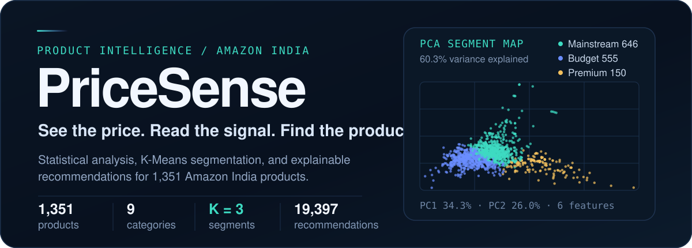
</p>

<p align="center">
  
  
  
  
  
  
</p>

<p align="center">
  <strong>An end-to-end analysis of 1,351 Amazon India products — from messy CSV to explainable segments and recommendations.</strong>
</p>

<p align="center">
  <a href="#overview">Overview</a> ·
  <a href="#inside-the-app">Inside the app</a> ·
  <a href="#analytics-showcase">Analytics</a> ·
  <a href="#how-it-works">Pipeline</a> ·
  <a href="#quickstart">Quickstart</a> ·
  <a href="#methodology">Methodology</a> ·
  <a href="#results">Results</a> ·
  <a href="#limitations">Limitations</a>
</p>

## Overview

PriceSense is an end-to-end data science project built on a **static Amazon India product catalog**. It takes a raw marketplace CSV through cleaning, descriptive analysis, exploratory visualization, K-Means segmentation, and a rule-based recommendation engine — then exposes the results through a five-page Streamlit dashboard.

The project deliberately favors **explainability over complexity**:

- The only trained segmentation model is K-Means; PCA is used only to visualize the cluster space.
- Recommendations are explicit filters and rankings, not a black-box model.
- Every chart and metric is reproducible from the data and scripts in this repository.

| If you want to know… | Open |
|:--|:--|
| Which products are cheap but still well rated? | **Recommendation → Budget Alternatives** |
| Is a bigger discount associated with a better rating? | **EDA → Correlations** (weak negative: r = −0.16) |
| Which categories discount the deepest? | **EDA → Category Analysis** |
| How does PriceSense group the catalog? | **Clustering → PCA & profiles** |
| What should I look at next if I like this product? | **Recommendation** — five transparent strategies |

## Inside the app

The dashboard has five pages: **Home**, **EDA**, **Clustering**, **Recommendation**, and **About**. The screenshots below are from the local app at 1600 px wide — no mockups. Click any screenshot to open it full size.

| Home | EDA |
|:---:|:---:|
| <a href="assets/screenshots/dashboard-home.png">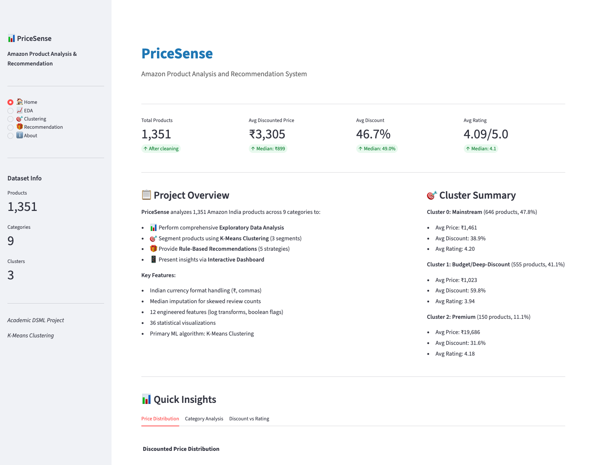</a> | <a href="assets/screenshots/eda-correlations.png">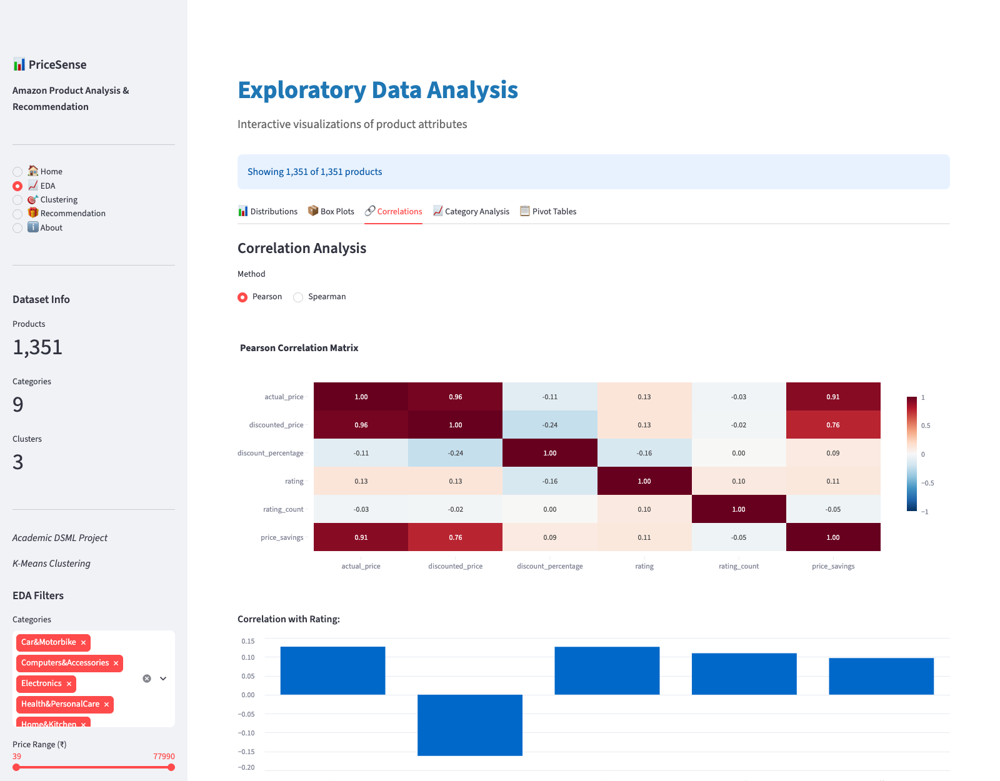</a> |
| <sub><em>Catalog metrics, cluster summaries, and shortcuts into the analysis.</em></sub> | <sub><em>Pearson/Spearman correlations update with the sidebar filters.</em></sub> |

| Clustering | Recommendation |
|:---:|:---:|
| <a href="assets/screenshots/clustering-pca.png">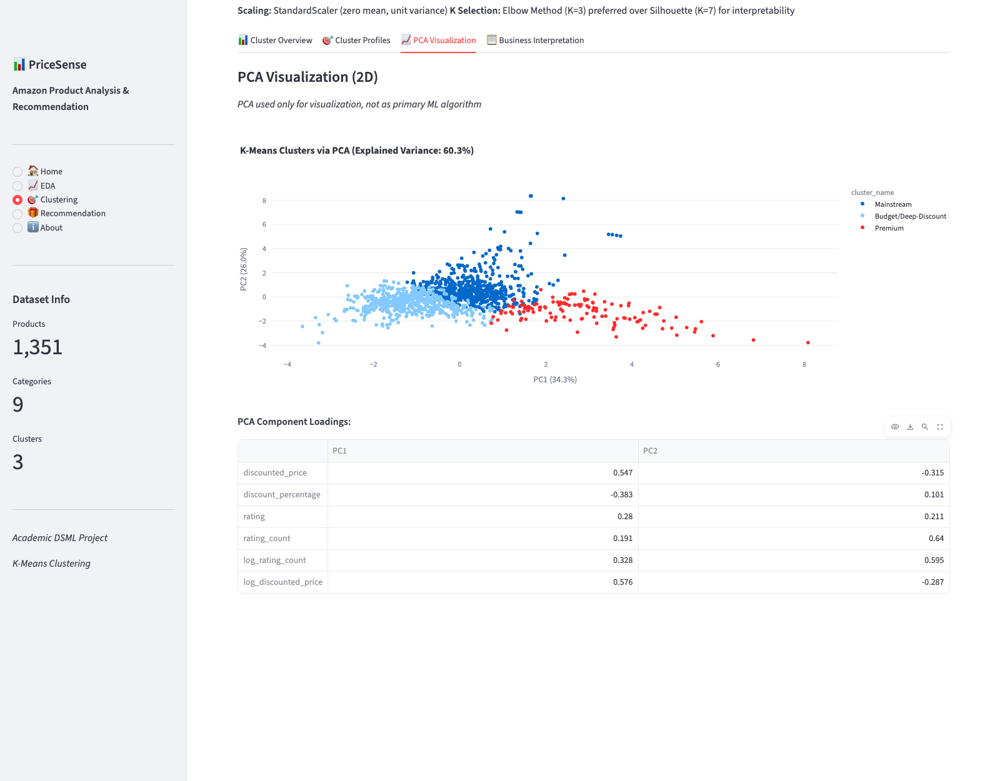</a> | <a href="assets/screenshots/recommendation-engine.png">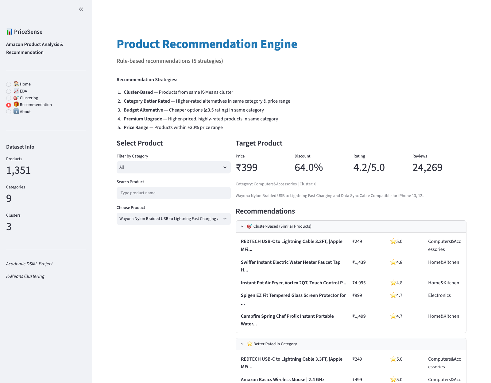</a> |
| <sub><em>PCA projection: 60.3% of variance in two dimensions.</em></sub> | <sub><em>Pick a product, choose a strategy, inspect the ranked shortlist.</em></sub> |

## Analytics showcase

Eight of the 42 generated charts (36 EDA + 6 clustering). All use the cleaned data in `outputs/cleaned_data.csv`; the complete set lives in [`outputs/charts/`](outputs/charts/). Click any chart to open it full size.

### Price and discount patterns

| Distribution of discounted prices | Distribution of discount percentages |
|:---:|:---:|
| <a href="outputs/charts/discounted_price_distribution.png">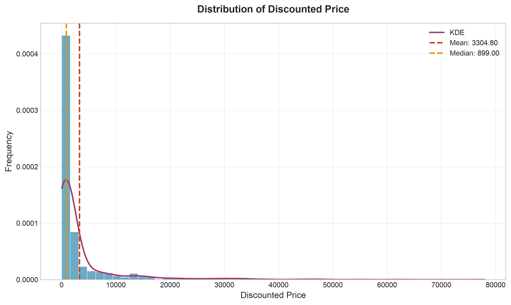</a> | <a href="outputs/charts/discount_percentage_distribution.png">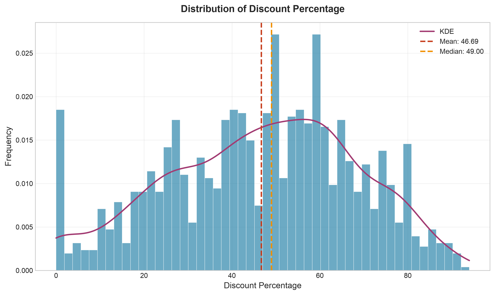</a> |
| <sub><em>Right-skewed: mean ₹3,305 vs median ₹899; P99 ₹35,499.</em></sub> | <sub><em>Broad discounts: median 49%, IQR 31–62%.</em></sub> |

| Mean discount by main category |
|:---:|
| <a href="outputs/charts/mean_discount_percentage_by_main_category.png">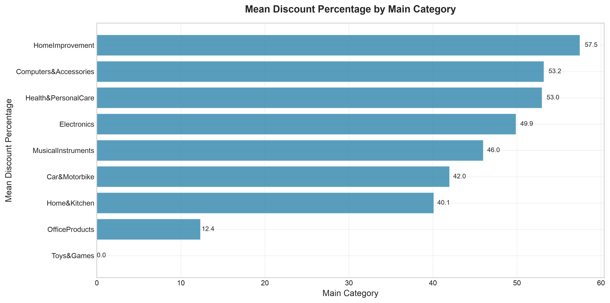</a> |
| <sub><em>Among the three largest categories, Computers & Accessories leads at 53.2%; Home & Kitchen sits at 40.1%. Small categories are noisy — Home Improvement's 57.5% comes from two products.</em></sub> |

### What moves together

| Pearson correlation matrix | Category × discount band |
|:---:|:---:|
| <a href="outputs/charts/correlation_heatmap_pearson.png">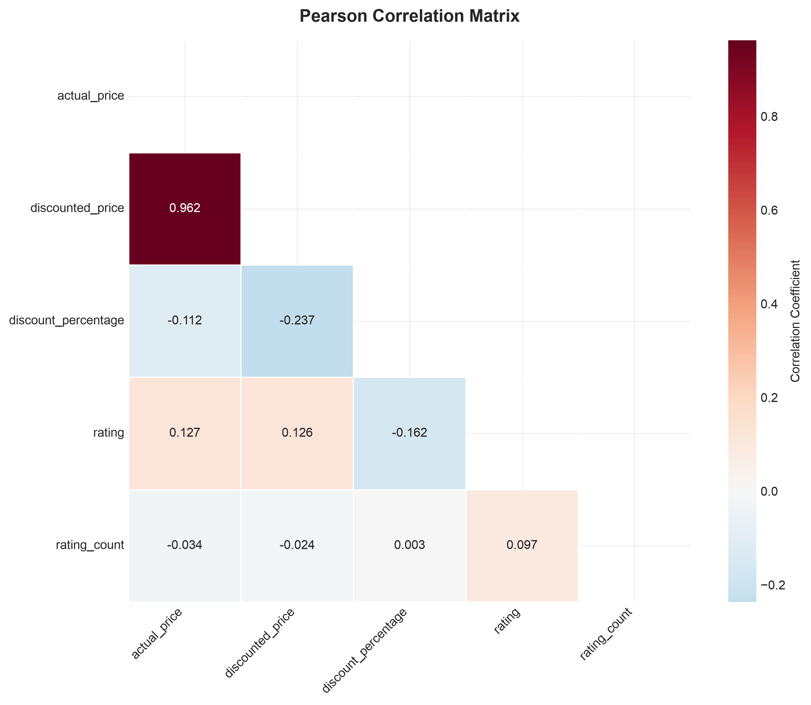</a> | <a href="outputs/charts/pivot_main_category_discount_band_count.png">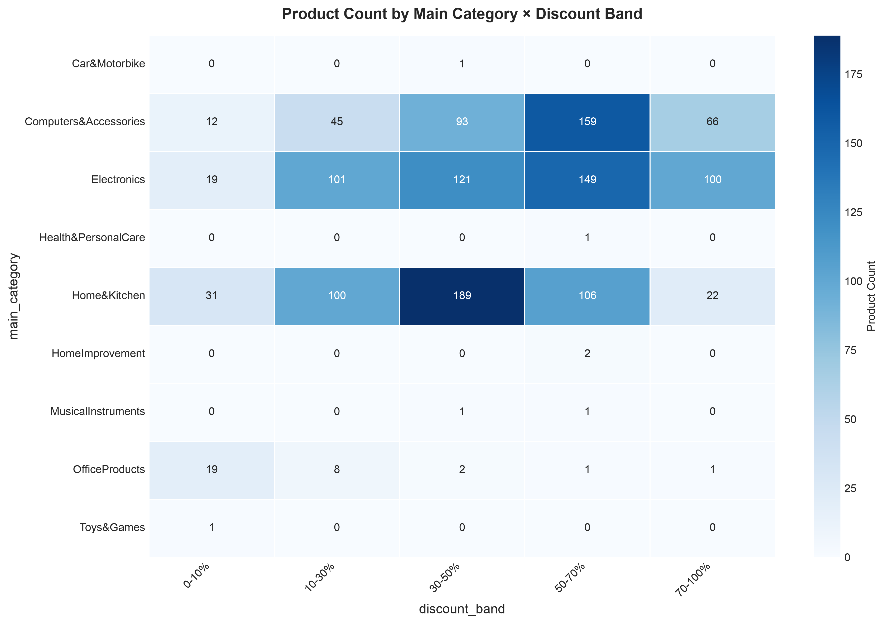</a> |
| <sub><em>Actual and discounted price are almost interchangeable (r = 0.96). Rating has weak relationships with price (0.13) and discount (−0.16).</em></sub> | <sub><em>Home & Kitchen dominates the 30–50% band (189 products); Computers & Accessories peaks at 50–70% (159).</em></sub> |

### Segmentation

| Choosing K: inertia and silhouette | Category mix by segment |
|:---:|:---:|
| <a href="outputs/charts/elbow_method.png">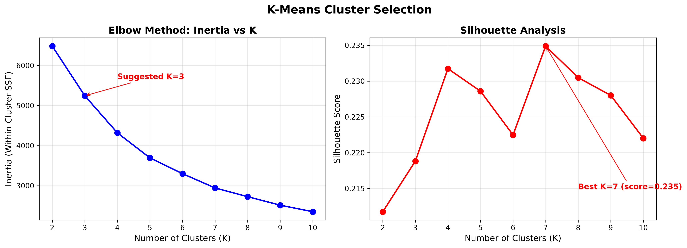</a> | <a href="outputs/charts/cluster_category_composition.png">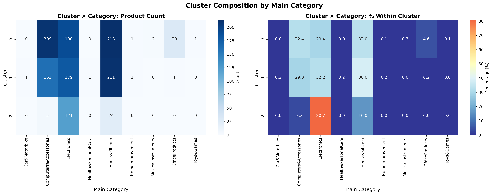</a> |
| <sub><em>Inertia falls sharply to K=3; silhouette peaks at K=7 (0.235), but K=3 (0.219) is kept for interpretability.</em></sub> | <sub><em>Electronics is 80.7% of the premium segment; Home & Kitchen leads the mainstream and budget segments.</em></sub> |

| Normalized cluster profiles |
|:---:|
| <a href="outputs/charts/cluster_profiles.png">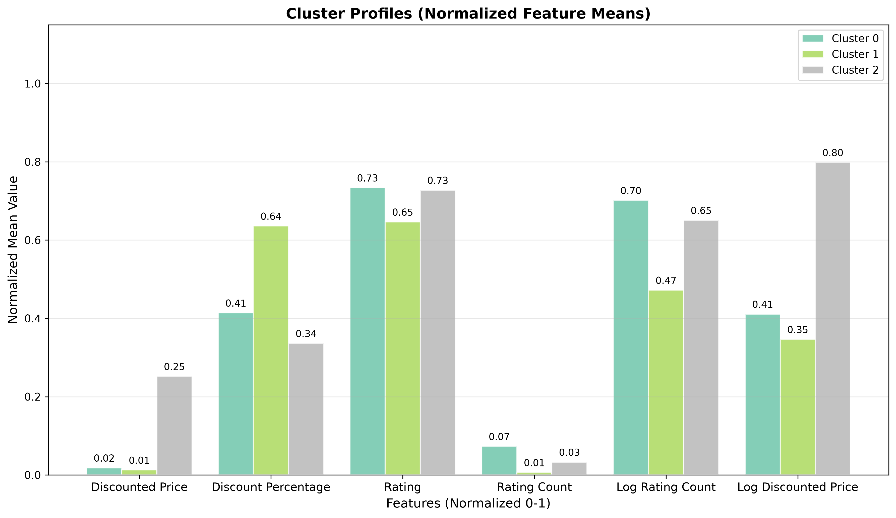</a> |
| <sub><em>Min–max normalized means for the six clustering features. Premium is defined mainly by price; budget by deep discounts and lower ratings; mainstream by rating volume.</em></sub> |

## How it works

<p align="center">
  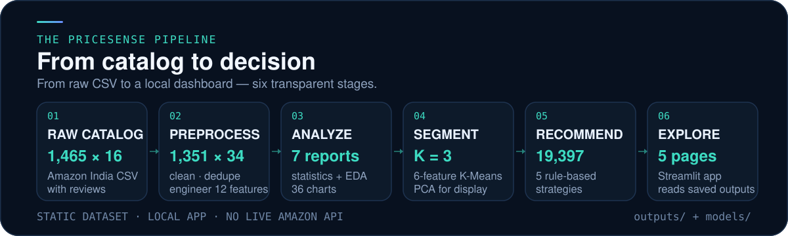
</p>

| Stage | What happens | Output |
|:--|:--|:--|
| **1. Load** | Read the raw static catalog. | `data/amazon.csv` (1,465 × 16) |
| **2. Clean** | Parse currency and percentage strings, impute two missing rating counts with the median (4,740), remove 114 repeated product IDs, and derive 12 features. | `outputs/cleaned_data.csv` (1,351 × 34) |
| **3. Analyze** | Descriptive statistics and 36 exploratory charts. | 7 CSVs + 36 PNGs |
| **4. Segment** | Scale six numeric features, fit K-Means for K=2–10, keep K=3, and project to 2D with PCA. | `cluster_results.csv` + model artifacts + 6 charts |
| **5. Recommend** | Build five product-to-product strategies and rank candidates. | 19,397 rows in `recommendations.csv` |
| **6. Explore** | Streamlit reads the artifacts; the clustering page recomputes PCA for display. | Five-page local app |

## Dataset

| Attribute | Value |
|:--|:--|
| **Source** | Static Amazon India product catalog with aggregated review text, committed to the repository. No live Amazon API, scraping, or price tracking. |
| **Raw shape** | 1,465 rows × 16 columns (~4.5 MB). |
| **Cleaned shape** | 1,351 unique products × 34 columns, including 12 engineered features. |
| **Deduplication** | 114 repeated `product_id` rows removed; 0 exact duplicate rows. |
| **Categories** | 9 main categories, 211 unique category paths, depth 2–7. |
| **Key fields** | `product_id`, `product_name`, `category`, `discounted_price`, `actual_price`, `discount_percentage`, `rating`, `rating_count`. |
| **Not included** | Timestamps, live prices, individual purchase events, user behavior. |
| **Privacy** | The raw CSV and cleaned data retain reviewer names and review text for provenance. The dashboard does not display them; modeling uses only aggregate count/length fields plus non-text product attributes. |

**Class imbalance is real.** Electronics (490), Home & Kitchen (448), and Computers & Accessories (375) account for 97.2% of the cleaned catalog. The remaining six categories have 1–31 products each, so their category-level charts are descriptive only.

## Technology stack

| Layer | Tools |
|:--|:--|
| **Language** | Python 3.10+ (tested with 3.14) |
| **Data** | pandas 2+, NumPy |
| **Machine learning** | scikit-learn 1+ (K-Means, PCA, StandardScaler, silhouette) |
| **Visualization** | Matplotlib, Seaborn, Plotly |
| **Dashboard** | Streamlit 1+ |
| **Notebook** | Jupyter / ipykernel |
| **Persistence** | CSV outputs and joblib model artifacts |

> `scipy.stats` is imported directly by `src/descriptive_stats.py`; it is installed as a scikit-learn dependency rather than pinned in `requirements.txt`.

No cloud services, databases, or API keys are required.

## Quickstart

> **Local-first.** There is no verified public deployment URL in this repository. Run the app locally; it opens at `http://localhost:8501`.

### 1. Clone and enter

```bash
git clone https://github.com/thenameisomm/PriceSense.git
cd PriceSense
```

### 2. Create an environment

```bash
python -m venv .venv
source .venv/bin/activate        # macOS / Linux
# .venv\Scripts\activate         # Windows

pip install --upgrade pip
pip install -r requirements.txt
```

### 3. Run the dashboard

```bash
streamlit run src/app.py
```

Run this from the repository root: the app loads `outputs/` and `models/` with relative paths. The checked-in artifacts are enough for the dashboard.

### 4. Rebuild the analysis (optional)

Run from the repository root, in order:

```bash
python src/preprocessing.py
python src/descriptive_stats.py
python src/eda.py
python src/clustering.py
python src/recommendation.py
```

`src/clustering.py` writes the model artifacts; `src/recommendation.py` depends on the cluster assignments. Re-running the full pipeline replaces the CSVs, charts, and models. The exploratory notebook is at `notebooks/PriceSense_Analysis.ipynb`.

> **Deployment note:** if you deploy to Streamlit Community Cloud, set the entry point to `src/app.py` and keep `outputs/` and `models/` in the repository. No live deployment is included or verified here.

## Usage

| Page | What it does | Start here |
|:--|:--|:--|
| **Home** | Catalog KPIs, project overview, segment cards, and quick insights. | Check the three segment summaries. |
| **EDA** | Distributions, category comparisons, correlations, and pivot tables. | Switch between Pearson and Spearman. |
| **Clustering** | Cluster sizes, PCA projection, loadings, profiles, and category mix. | Open the PCA visualization tab. |
| **Recommendation** | Product-to-product recommendations across five strategies. | Compare Budget Alternatives with Premium Upgrades. |
| **About** | Method, dataset notes, syllabus compliance, and academic scope. | Read the limitations below before quoting results. |

## Methodology

### Preprocessing

- Parse `₹1,299.00` strings into numeric prices and `53%` strings into floats.
- Remove the `₹` prefix and thousands separators.
- Drop 114 repeated `product_id` rows; no exact duplicate rows exist.
- Impute the two missing `rating_count` values with the median (4,740).
- Build category fields: `main_category`, `sub_category`, and `category_depth`.
- Derive 12 features: savings, discount depth, price ratio, rating flags, budget/premium flags, log transforms, parsed review count, and average review length.

### Descriptive analysis

`outputs/statistics/` contains 7 CSVs covering summary statistics, correlation, covariance, category and discount-band groupings, and two pivots. Correlation is reported, not interpreted as causation.

### EDA

The 36 EDA charts in `outputs/charts/` cover univariate distributions, category comparisons, bivariate relationships, and multivariate views. The dashboard adds interactive Plotly versions and sidebar filters.

### K-Means segmentation

Six numeric features are scaled with `StandardScaler`:

`discounted_price`, `discount_percentage`, `rating`, `rating_count`, `log_rating_count`, `log_discounted_price`.

K-Means is fit for K=2–10 with `random_state=42` and `n_init=10`. K=3 is retained for interpretability, even though K=7 has a slightly higher silhouette score.

<details>
<summary><strong>Full K selection table</strong></summary>

| K | Inertia | Silhouette |
|---:|---:|---:|
| 2 | 6,483.67 | 0.2118 |
| 3 | 5,243.38 | 0.2188 |
| 4 | 4,318.21 | 0.2317 |
| 5 | 3,693.07 | 0.2286 |
| 6 | 3,299.61 | 0.2225 |
| 7 | 2,942.85 | 0.2349 |
| 8 | 2,725.19 | 0.2305 |
| 9 | 2,512.65 | 0.2280 |
| 10 | 2,350.26 | 0.2220 |

</details>

| Segment | Profile | Products | Share | Avg. price | Avg. discount | Avg. rating | Avg. rating count |
|:--:|:--|--:|--:|--:|--:|--:|--:|
| **0** | Mainstream | 646 | 47.8% | ₹1,461 | 38.9% | 4.20 | 31,196 |
| **1** | Budget / deep-discount | 555 | 41.1% | ₹1,023 | 59.8% | 3.94 | 2,780 |
| **2** | Premium | 150 | 11.1% | ₹19,686 | 31.6% | 4.18 | 14,108 |

Segment names are dashboard display labels. `outputs/cluster_interpretations.csv` stores the pipeline's heuristic labels (`Average`, `Low-Rating`, `High-Price / Low-Discount`).

The PCA projection explains **60.3%** of variance in two dimensions (PC1 34.3%, PC2 26.0%). Clusters overlap; the silhouette of 0.219 is modest, so segment boundaries should be read as descriptive, not definitive.

### Recommendation

| Strategy | Candidate rule | Ranking |
|:--|:--|:--|
| **Cluster-based** | Same cluster; exclude target | Rating desc, rating count desc |
| **Category better rated** | Same category; rating ≥ target + 0.2; price within ±50% | Rating improvement desc, rating count desc |
| **Budget alternative** | Same category; price ≤ 70% of target; rating ≥ 3.5 | Rating / (price + 1) desc |
| **Premium upgrade** | Same category; price ≥ 1.5× target; rating ≥ 4.0 | Rating desc, price asc |
| **Price range** | Any category; price within ±30% | Rating desc |

The dashboard uses these five strategies. `src/recommendation.py` also contains `recommend_products()`, a preference-based filter for category, maximum price, minimum rating, and minimum discount. It scores candidates with 40% rating, 30% log rating count, 20% discount, plus a small cluster-priority bonus — but it is **not currently exposed as a dashboard page**.

## Project structure

```text
PriceSense/
├── .devcontainer/              # Optional dev container
├── assets/
│   ├── pipeline.svg
│   ├── pricesense-banner.svg
│   └── screenshots/            # Four real app screenshots
├── data/
│   └── amazon.csv              # Raw static catalog
├── models/
│   ├── feature_names.pkl
│   ├── kmeans_model.pkl
│   └── scaler.pkl
├── notebooks/
│   └── PriceSense_Analysis.ipynb
├── outputs/
│   ├── charts/                 # 42 PNGs
│   ├── statistics/             # 7 CSVs
│   ├── cleaned_data.csv
│   ├── cluster_results.csv
│   ├── recommendations.csv
│   └── cluster_*               # Profiles, category mixes, interpretations
├── src/
│   ├── app.py                  # Streamlit dashboard
│   ├── preprocessing.py
│   ├── descriptive_stats.py
│   ├── eda.py
│   ├── clustering.py
│   └── recommendation.py
├── PROJECT_PLAN.md
├── PROJECT_RULES.md
├── requirements.txt
└── README.md
```

## Results

| Signal | Result |
|:--|:--|
| **Price spread** | Mean ₹3,305, median ₹899, P99 ₹35,499, max discounted price ₹77,990 (max sticker price ₹139,900). |
| **Discounts** | Mean 46.7%, median 49%, IQR 31–62%. |
| **Ratings** | Mean 4.09, range 2.0–5.0; 90% of products are rated 3.7 or higher. |
| **Rating volume** | Median 4,740 ratings; maximum 426,973 — extremely right-skewed. |
| **Correlation (Pearson)** | Actual vs discounted price 0.96; discount vs rating −0.16; price vs rating 0.13. |
| **Segments** | 646 mainstream, 555 budget / deep-discount, 150 premium. |
| **Premium mix** | 80.7% of the premium segment is Electronics. |
| **Recommendations** | 19,397 rows across five strategies. |

These are descriptive results from one static snapshot. They are not causal and do not generalize to live Amazon pricing.

## Limitations

| Limitation | Why it matters |
|:--|:--|
| **Static snapshot** | No live prices, no refresh loop, and no guarantee that listed products are still available. |
| **No time dimension** | Trends, seasonality, and price history cannot be analyzed. |
| **Overlapping clusters** | Silhouette is 0.219; K=7 scores slightly higher, but K=3 was chosen for interpretability. |
| **Imbalanced categories** | Three categories account for 97.2% of the catalog, so minority-category comparisons are noisy. |
| **Six numeric features** | Categorical attributes are not encoded into the clustering model. |
| **Rule-based recommender** | Content-blind, not personalized, and not trained on user behavior. |
| **Aggregated review text** | No row-level reviews, NLP, or sentiment analysis. |
| **Precomputed artifacts** | The app reads checked-in outputs; rerun the pipeline after changing the data. |
| **No verified deployment** | The repository does not include a live URL. |

## Future improvements

None of these are implemented yet:

- Surface the preference-based recommender in the dashboard.
- Add a side-by-side product comparison view.
- Test cluster stability across multiple seeds and bootstrap samples.
- Add automated data-validation tests for the preprocessing pipeline.
- Add downloadable filtered datasets and chart exports.
- Add a verified Streamlit Community Cloud deployment.

## Academic context

PriceSense is an academic data-science submission, not a production recommendation system. The project stays within the constraints recorded in [`PROJECT_RULES.md`](PROJECT_RULES.md): K-Means for segmentation, PCA for visualization, and transparent rule-based recommendations. The original plan is in [`PROJECT_PLAN.md`](PROJECT_PLAN.md).

The prohibited techniques in `PROJECT_RULES.md` — time-series forecasting, gradient-boosted trees, deep learning, NLP, collaborative filtering, web scraping/live APIs, and advanced recommenders — are not implemented.

## Author

**Om Badgujar** · [@thenameisomm](https://github.com/thenameisomm)

No `LICENSE` file is included. The repository is shared for educational use; add a license before redistributing.

---

<p align="center">
  <sub>PriceSense · Amazon product intelligence · Python · scikit-learn · Streamlit</sub><br>
  <sub><a href="#top">Back to top</a></sub>
</p>
